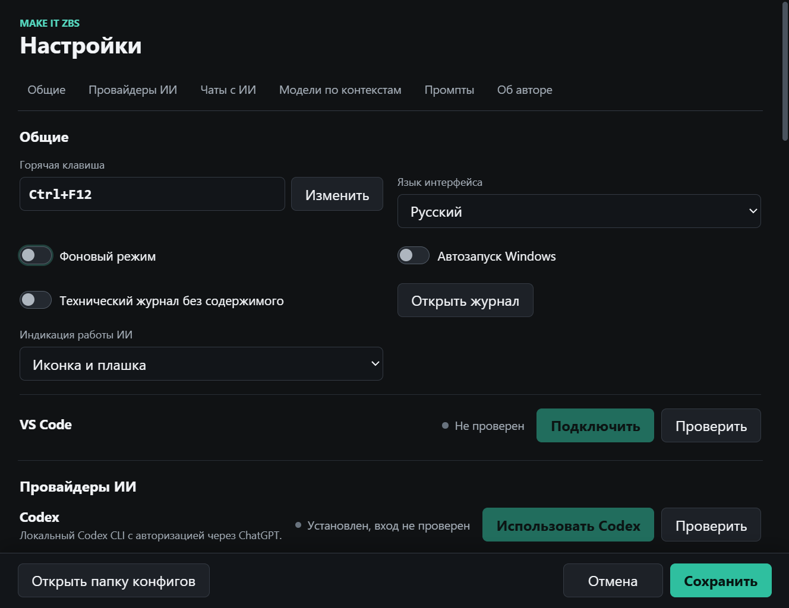
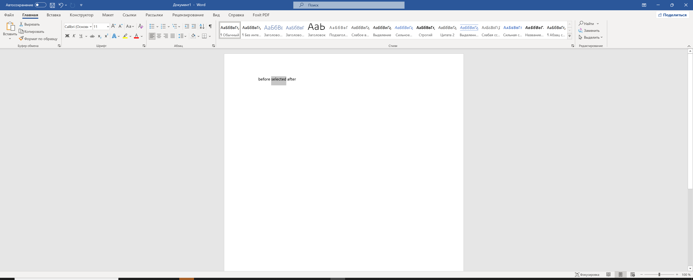
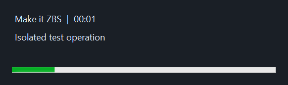
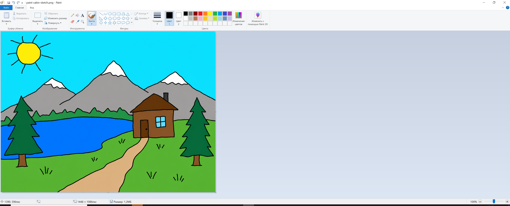

# Make it ZBS: инструкция со скриншотами

## Установка

Скачайте ZIP и файл `.zip.sha256` из [beta.4](https://github.com/andromanpro/make-it-zbs/releases/tag/v0.5.0-beta.4).
Проверьте SHA-256 по [инструкции установки](../INSTALL.md), распакуйте весь архив
в папку с правом записи и запустите `MakeItZBS.exe`. Приложение появится **в трее**,
а не как постоянно открытое окно. Если значок скрыт, раскройте дополнительные
значки рядом с часами Windows. Через меню значка откройте настройки.

Beta не подписана Authenticode. Хеш подтверждает целостность файла, но не личность
издателя. Не отключайте защиту Windows ради запуска неизвестного файла.

## Провайдер, клавиша и индикация

На снимке показан изолированный тестовый профиль, не ваши сохранённые настройки.
Статус Codex «Установлен, вход не проверен» не означает, что подписка подключена.

1. Выберите язык интерфейса: русский или английский.
2. Нажмите «Изменить» у горячей клавиши, введите удобное сочетание и сохраните.
   Если оно занято другим приложением, выберите другое.
3. Для Codex установите CLI и выполните личный вход, затем нажмите «Проверить».
   Кнопка «Использовать Codex» выбирает провайдера явно; существующий OpenRouter
   не должен переключаться только из-за обнаружения CLI.
4. Для OpenRouter укажите свой ключ и модель. Запросы оплачиваются по условиям
   провайдера; наличие подписки ChatGPT не оплачивает OpenRouter.
5. Выберите индикацию: иконка, плашка, оба варианта либо без индикации.
   Нажмите «Сохранить». «Отмена» не применяет изменения.

## Текст в Word

1. Сначала проверьте сценарий на ненужном документе. Выделите только нужный текст.
2. Нажмите настроенную горячую клавишу. Передаётся захваченный контекст;
   не выбирайте секретные сведения и чужие персональные данные.
3. Проверьте результат в Preview, особенно числа, даты, имена и смысл.
4. Применяйте Replace только после проверки. Если исходное окно или выделение
   изменились, повторно захватите контекст, не пытайтесь обойти защиту.

На снимке настоящий Word с тестовым текстом `before selected after`.
Это пример выделения, **не демонстрация ответа ИИ**. Обычный пользовательский
маршрут не требует установки тестового стенда или запуска скриптов.

## Пока идёт запрос

Таймер показывает прошедшее время, а не оценку оставшегося времени.
На иллюстрации используется тестовая подпись `Isolated test operation`.
Повторные нажатия во время обработки не создают очередь скрытых запросов.
Для отмены используйте команду «Отменить обработку» в трее.
При отмене результат этой операции не должен применяться позже.

## Рисунок в Paint

Оставьте рисунок видимым и нажмите горячую клавишу. Для генерации или улучшения
картинки необходим настроенный провайдер изображений. Поддержка изображений
на входе у текстовой модели не равна возможности генерировать картинку на выходе.
Проверьте результат перед сохранением; оригинальный рисунок не удаляйте.
Снимок показывает исходный тестовый рисунок, а не обещанное качество генерации.

## Code, AI-чаты и ограничения

Для VS Code в настройках есть подключение адаптера: он поставляется вместе
с приложением, но требует установки расширения в сам редактор. Это необходимо
для проверки документа, его версии и безопасного Undo.

Для Codex, Claude и OpenCode начните с режима черновика в отдельном тестовом чате.
Проверьте выбранное окно и текст до отправки. Поддержка профиля не означает
совместимость со всеми версиями клиента. [Короткая ручная проверка](manual-smoke/ai-chat-quick-check.md).

Скриншоты сделаны в Windows 10 на синтетических данных во время UI-тестов
18.10.2026. Они не подтверждают прогон Windows 11, нескольких мониторов,
настоящих AI-чатов или доступность конкретного провайдера.
[Все ограничения](../INSTALL.md) · [Приватность и резервные копии](../PRIVACY.md).
